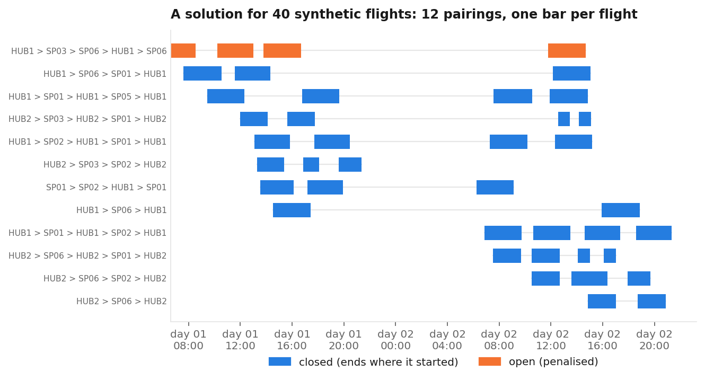
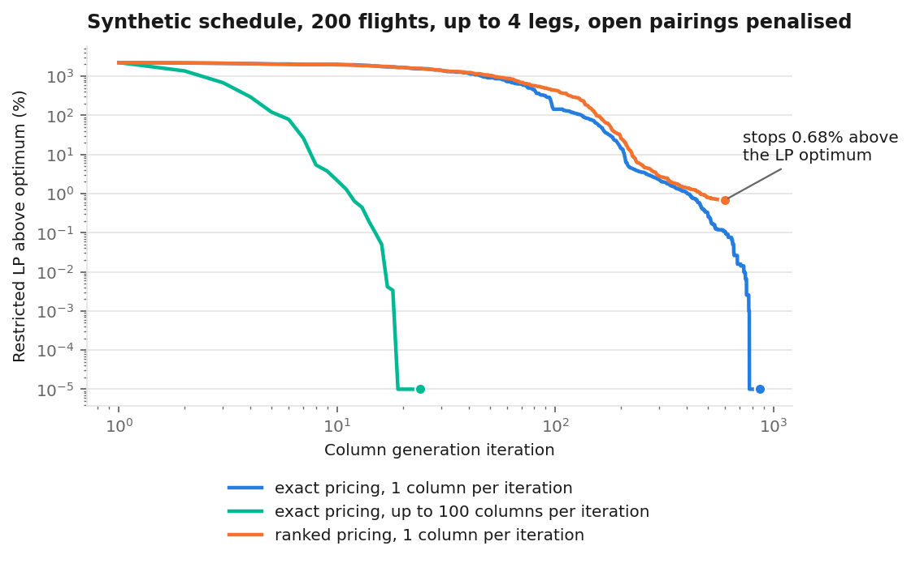

# Crew pairing by column generation

Airlines have to split a flight schedule into pairings: chains of flights that one crew flies one after another. With Axel Rivas and Tomás Schmidt I worked on this problem for IN7605, Heuristics for Integer Optimization and Applications (Universidad de Chile and Universidad de Buenos Aires, 2025). This repository is a small, tested Python version of that work.

It also fixes something I found when revisiting it: with a penalty on pairings that do not return to their starting airport, the pricing step described in our report stops too early. The "lower bounds" it reported for that variant are higher than the cost of real solutions.



## The problem

Cover every flight exactly once with pairings of at most `L` legs, at minimum total cost. Two flights can be chained if the second leaves from the airport where the first lands, at least 30 minutes later.

| cost component | value |
|---|---:|
| opening a pairing | 400 |
| per minute of flying | 1 |
| each connection | 20 |
| per minute waiting beyond the turnaround | 0.1 |
| pairing that ends away from where it started (penalised variant) | 10,000 |

These costs are our own modelling choice. As a set partitioning problem there is one binary variable per feasible pairing, far too many to list.

## Method

- **Master problem.** LP relaxation over a small set of pairings, solved with HiGHS through SciPy. It starts from one pairing per flight.
- **Pricing.** A dynamic program over (last flight, number of legs) looks for pairings with negative reduced cost. Flights sorted by departure give the topological order.
  - `ranked`: our project's penalised variant. Run the program ignoring the penalty, keep the cheapest path per state, add the penalty afterwards.
  - `exact`: run the program once per origin airport. Within one run, whether a pairing is closed depends only on the state, so nothing useful gets discarded.
- **Integer solution.** A binary solve over the generated columns only (price and branch), limited to 60 seconds.
- **Reference.** A greedy heuristic that chains the cheapest free connection.

Why `ranked` fails: suppose an open path and a slightly more expensive closed path reach the same flight with the same number of legs. Only the open one is kept. Once penalised it is not worth adding, the closed one was never remembered, and column generation concludes there is nothing left to add. [`tests/test_crewpairing.py`](tests/test_crewpairing.py) has a three flight example.



## Data

- **Benchmark instance.** `instance1` from the crew scheduling data sets of Quesnel, Kasirzadeh and Soumis (GERAD, *Description of Data Sets and Generators*, 2014), taking the first 100, 200 or 250 departures. The data is not redistributed here; only my aggregate results are.
- **Synthetic schedules.** A seeded hub and spoke generator, so that everything can be run without that data. It is not airline data.

## Results

### Penalised variant, instance1

"Here" means exact pricing, adding up to 100 columns per iteration. All integer solves in this table finished within the time limit.

| flights | L | bound in our report | solution in our report | exact LP bound | solution here | cost change |
|---:|---:|---:|---:|---:|---:|---:|
| 100 | 4 | 105,094.85 | 105,407.20 | 104,887.55 | 104,989.20 | -0.4% |
| 100 | 5 | 84,582.60 | 84,658.80 | 83,901.10 | 84,069.00 | -0.7% |
| 200 | 4 | 162,964.12 | 163,861.60 | 160,760.70 | 160,874.40 | -1.8% |
| 200 | 5 | 142,488.38 | 152,928.90 | 138,764.17 | 138,895.50 | -9.2% |
| 250 | 4 | 174,850.75 | 185,671.60 | 173,050.40 | 173,253.10 | -6.7% |
| 250 | 5 | 153,903.09 | 158,900.30 | 142,489.04 | 142,703.40 | -10.2% |

In all six cases the solution found here is cheaper than the bound in the report, so that bound was not valid. The report used Gurobi and a different integer heuristic, so the cost change mixes both differences; the LP bounds isolate the effect of pricing. Running `ranked` in this package gives LP values close to the report's but not identical. Where an inexact pricing stops can depend on which columns arrive first, and I have not rerun the original code, which needs Gurobi.

### Without the penalty, instance1

Here both pricing methods are the same and exact. The LP bounds match the report's in all six cases, to the two decimals it prints, which is a useful check on the new code.

| flights | L | LP bound (report and here) | solution in our report | solution here |
|---:|---:|---:|---:|---:|
| 100 | 4 | 23,976.80 | 24,066.50 | 24,066.50 |
| 100 | 5 | 22,178.40 | 22,353.00 | 22,199.90 |
| 200 | 4 | 48,141.65 | 48,246.50 | 48,229.90 |
| 200 | 5 | 44,568.79 | 44,836.70 | 44,632.10 |
| 250 | 4 | 60,458.10 | 60,676.40 | 60,594.80 |
| 250 | 5 | 56,044.17 | 56,051.50 | 56,051.50 |

### One column per iteration or many

In the report we argued for adding a single column per iteration. Adding up to 100 reaches the same LP bound much faster (penalised, instance1):

| flights | L | iterations, 1 column | iterations, 100 columns | seconds, 1 column | seconds, 100 columns |
|---:|---:|---:|---:|---:|---:|
| 100 | 4 | 324 | 22 | 4.7 | 0.4 |
| 100 | 5 | 480 | 35 | 7.8 | 0.7 |
| 200 | 4 | 865 | 28 | 41.9 | 1.4 |
| 200 | 5 | 1,196 | 44 | 101.7 | 10.5 |
| 250 | 4 | 1,333 | 38 | 84.5 | 2.1 |
| 250 | 5 | 1,595 | 51 | 282.4 | 18.2 |

Times are column generation only, on a laptop CPU that was busy with other jobs, so read them as orders of magnitude. The larger pool of columns often gives a better integer solution too, though not always. The biggest gain between two proven solutions is with 200 flights and `L = 4`, from 170,504.7 down to 160,874.4.

### Synthetic schedules (penalised)

| flights | L | greedy | `ranked` LP value | exact LP bound | solution, exact with 100 columns |
|---:|---:|---:|---:|---:|---:|
| 100 | 4 | 162,333 | 57,283 | 57,136 | 57,173 |
| 100 | 5 | 172,063 | 55,683 | 55,543 | 55,653 |
| 200 | 4 | 262,126 | 91,032 | 90,416 | 90,432 |
| 200 | 5 | 250,860 | 87,453 | 86,984 | 87,041 |
| 250 | 4 | 305,090 | 114,883 | 111,167 | 111,181 |
| 250 | 5 | 292,583 | 109,947 | 106,282 | 106,282 |

The same effect shows up: every solution in the last column costs less than the `ranked` value next to it.

### A warning about the integer phase

Some integer solves hit the 60 second limit, on the larger problems and most often with `ranked` columns. Their cost is only the best found by then and changes from run to run and machine to machine. They are marked `integer_proven = False` in [`results/`](results/). LP bounds do not depend on that limit.

## Run it

Python 3.10 or later. No commercial solver needed.

```bash
pip install -r requirements.txt
pytest
python run_experiments.py                              # synthetic, about 40 minutes on my busy laptop
python run_experiments.py --instance path/to/instance1 # if you have the GERAD files
python make_figures.py
```

Most of that time goes into the single column runs. To try something small:

```python
from crewpairing import CostModel, Network, solve, synthetic_instance

net = Network(synthetic_instance(60, seed=1), CostModel(open_penalty=10_000))
result = solve(net, max_legs=4, columns_per_iteration=100)
print(result.objective, result.lp_bound, result.gap)
```

## Limitations

- No duty time, rest or crew base rules. "Closed" only means ending at the starting airport.
- Waiting is cheap and unbounded, so a pairing can sit overnight.
- No new columns are priced during the integer phase.

## Layout

```
crewpairing/        data loading and generator, network, pricing, master, solve
run_experiments.py  comparison tables
make_figures.py     figures in this README
results/            my runs (synthetic.csv, instance1.csv) and the report's tables
report/             our project report, in Spanish
tests/
```

## Authorship

The project and its report are joint work by Axel Rivas, Tomás Schmidt and me. The code here is a later rewrite of our column generation, in which I added the exact pricing, the HiGHS integer phase, the synthetic generator, the greedy reference, the experiments, figures and tests. Our original integer phase ran on Gurobi with a feasibility pump heuristic built on course code, and it is not included.
